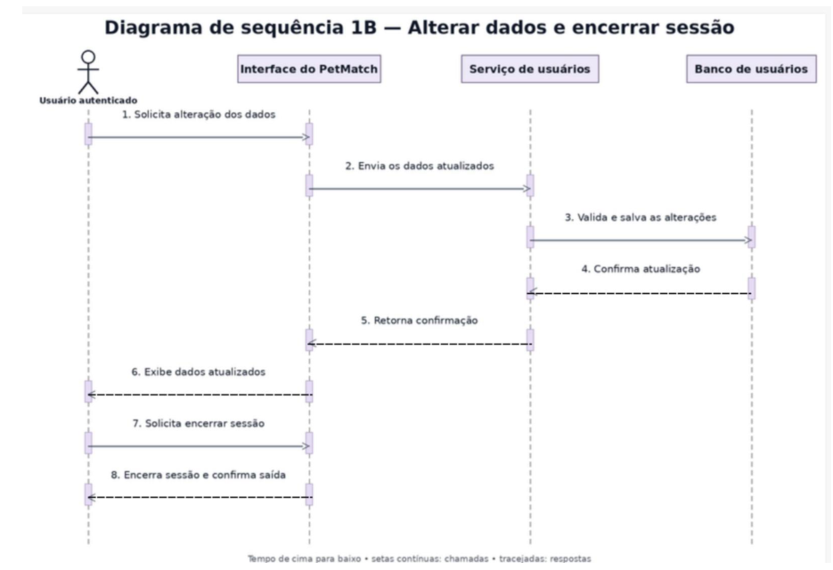
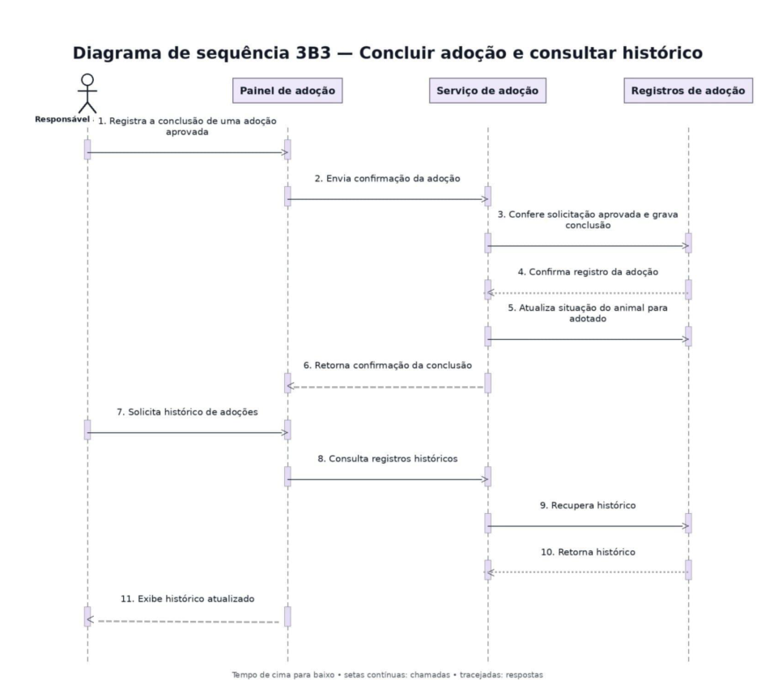
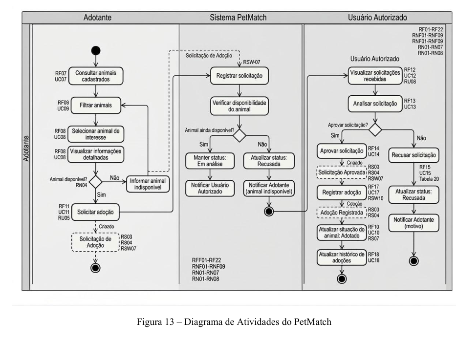

  

  
  
  

 

<strong>Sumário de Navegação</strong>

<a href="#1-introdução"><strong>1. Introdução</strong></a> 
&nbsp;&nbsp;&nbsp;&nbsp;<a href="#11-descrição-geral-do-software">1.1. Descrição Geral do Software</a> 
&nbsp;&nbsp;&nbsp;&nbsp;<a href="#12-descrição-dos-usuários">1.2. Descrição dos Usuários</a>  

<a href="#2-requisitos-gerais-do-software"><strong>2. Requisitos Gerais do Software</strong></a> 
&nbsp;&nbsp;&nbsp;&nbsp;<a href="#21-requisitos-funcionais">2.1. Requisitos Funcionais</a> 
&nbsp;&nbsp;&nbsp;&nbsp;<a href="#22-requisitos-não-funcionais">2.2. Requisitos Não Funcionais</a> 
&nbsp;&nbsp;&nbsp;&nbsp;<a href="#23-regras-de-negócio">2.3. Regras de Negócio</a>  

<a href="#3-diagramas-uml"><strong>3. Diagramas UML</strong></a> 
&nbsp;&nbsp;&nbsp;&nbsp;<a href="#31-diagramas-de-casos-de-uso">3.1. Diagramas de Casos de Uso</a> 
&nbsp;&nbsp;&nbsp;&nbsp;<a href="#32-diagramas-de-sequência">3.2. Diagramas de Sequência</a> 
&nbsp;&nbsp;&nbsp;&nbsp;<a href="#33-diagramas-de-atividades">3.3. Diagramas de Atividades</a>  

<a href="#integrantes"><strong>Integrantes</strong></a>

---

## 1. Introdução

### 1.1. Descrição Geral do Software

O **PetMatch** é um sistema de software projetado para estruturar, organizar e acompanhar o processo de cadastro, consulta, solicitação e conclusão de adoção de animais. A solução centraliza as informações dos animais disponíveis, padroniza o fluxo de análise das solicitações e preserva o histórico das movimentações realizadas na plataforma.

Com foco na rastreabilidade e na clareza operacional, o sistema conecta interessados em adotar com os responsáveis pela gestão e aprovação das adoções, reduzindo falhas de comunicação e garantindo controle sobre cada etapa do processo.

### 1.2. Descrição dos Usuários

A modelagem do **PetMatch** contempla os seguintes perfis de usuários e suas respectivas responsabilidades no sistema:

<table>
  <thead>
    <tr>
      <th align="left">Perfil</th>
      <th align="left">Descrição e Atribuições</th>
    </tr>
  </thead>
  <tbody>
    <tr>
      <td><strong>Adotante / Usuário Comum</strong></td>
      <td>Realiza cadastro e autenticação no sistema, atualiza seus dados pessoais, consulta e filtra animais disponíveis, seleciona animais de interesse e registra solicitações de adoção.</td>
    </tr>
    <tr>
      <td><strong>Responsável / Gestor de Adoções</strong></td>
      <td>Cadastra, edita e atualiza a situação dos animais, analisa solicitações pendentes, aprova ou recusa pedidos de adoção, conclui o processo e consulta o histórico de adoções.</td>
    </tr>
    <tr>
      <td><strong>Administrador</strong></td>
      <td>Realiza a administração geral da plataforma, incluindo o gerenciamento de contas de usuários, o acompanhamento de solicitações e a consulta aos registros do sistema.</td>
    </tr>
  </tbody>
</table>

---

## 2. Requisitos Gerais do Software

### 2.1. Requisitos Funcionais

<table>
  <thead>
    <tr>
      <th align="left">Código</th>
      <th align="left">Requisito</th>
      <th align="left">Descrição</th>
    </tr>
  </thead>
  <tbody>
    <tr>
      <td><strong>RF01</strong></td>
      <td>Cadastro e Autenticação</td>
      <td>O sistema deve permitir que usuários realizem cadastro, efetuem login, alterem seus dados pessoais e encerrem a sessão.</td>
    </tr>
    <tr>
      <td><strong>RF02</strong></td>
      <td>Consulta e Filtro de Animais</td>
      <td>O sistema deve permitir consultar, filtrar e visualizar detalhes e a situação atual dos animais cadastrados.</td>
    </tr>
    <tr>
      <td><strong>RF03</strong></td>
      <td>Gerenciamento de Animais</td>
      <td>O sistema deve permitir cadastrar novos animais, editar informações existentes e alterar a situação do animal.</td>
    </tr>
    <tr>
      <td><strong>RF04</strong></td>
      <td>Solicitação de Adoção</td>
      <td>O sistema deve permitir selecionar um animal disponível e validar e registrar uma solicitação de adoção.</td>
    </tr>
    <tr>
      <td><strong>RF05</strong></td>
      <td>Análise e Decisão de Adoção</td>
      <td>O sistema deve permitir analisar solicitações registradas e aprovar ou recusar o pedido de adoção.</td>
    </tr>
    <tr>
      <td><strong>RF06</strong></td>
      <td>Conclusão e Histórico</td>
      <td>O sistema deve permitir concluir processos de adoção aprovados e consultar o histórico de adoções.</td>
    </tr>
    <tr>
      <td><strong>RF07</strong></td>
      <td>Administração do Sistema</td>
      <td>O sistema deve permitir gerenciar usuários, gerenciar solicitações e consultar registros operacionais.</td>
    </tr>
  </tbody>
</table>

### 2.2. Requisitos Não Funcionais

<table>
  <thead>
    <tr>
      <th align="left">Código</th>
      <th align="left">Categoria</th>
      <th align="left">Especificação</th>
    </tr>
  </thead>
  <tbody>
    <tr>
      <td><strong>RNF01</strong></td>
      <td>Usabilidade</td>
      <td>A interface deve apresentar navegação clara e objetiva para facilitar consultas, filtros e acompanhamento de solicitações.</td>
    </tr>
    <tr>
      <td><strong>RNF02</strong></td>
      <td>Segurança</td>
      <td>O acesso às funcionalidades deve ser controlado por autenticação e autorização conforme o perfil do usuário.</td>
    </tr>
    <tr>
      <td><strong>RNF03</strong></td>
      <td>Confiabilidade</td>
      <td>As alterações de estado dos animais e das solicitações devem manter consistência e integridade nos registros.</td>
    </tr>
    <tr>
      <td><strong>RNF04</strong></td>
      <td>Manutenibilidade</td>
      <td>A arquitetura e a documentação UML devem manter organização modular para apoiar evoluções futuras do software.</td>
    </tr>
  </tbody>
</table>

### 2.3. Regras de Negócio

<table>
  <thead>
    <tr>
      <th align="left">Código</th>
      <th align="left">Regra</th>
      <th align="left">Detalhamento</th>
    </tr>
  </thead>
  <tbody>
    <tr>
      <td><strong>RN01</strong></td>
      <td>Restrição de Acesso Autenticado</td>
      <td>Operações de alteração de perfil, submissão de solicitação de adoção e rotinas administrativas exigem sessão autenticada.</td>
    </tr>
    <tr>
      <td><strong>RN02</strong></td>
      <td>Validação da Solicitação</td>
      <td>Uma solicitação de adoção somente é registrada após validação da elegibilidade e da situação do animal selecionado.</td>
    </tr>
    <tr>
      <td><strong>RN03</strong></td>
      <td>Consistência de Situação</td>
      <td>A situação do animal deve refletir o estágio real do processo (disponível, em análise ou adotado), evitando conflitos de adoção simultânea.</td>
    </tr>
    <tr>
      <td><strong>RN04</strong></td>
      <td>Rastreabilidade de Registros</td>
      <td>Todas as decisões de aprovação, recusa e conclusão de adoção devem permanecer registradas para consulta em histórico.</td>
    </tr>
  </tbody>
</table>

---

## 3. Diagramas UML

Os diagramas apresentados nesta seção encontram-se armazenados no diretório `docs/diagramas/` e representam a visão funcional, comportamental e interacional do **PetMatch**.

### 3.1. Diagramas de Casos de Uso

  
<strong>Diagrama de Casos de Uso — Visão Geral do Sistema</strong>

   
  

    
  

   

### 3.2. Diagramas de Sequência

Selecione cada fluxo abaixo para expandir e visualizar o respectivo diagrama de sequência:

  
<strong>01. Cadastro e Login</strong>

   
  

    
  

   

  
<strong>02. Alterar Dados e Encerrar Sessão</strong>

   
  

    
  

   

  
<strong>03. Consultar, Filtrar e Visualizar Animais</strong>

   
  

    
  

   

  
<strong>04. Cadastrar, Editar e Alterar Situação do Animal</strong>

   
  

    
  

   

  
<strong>05. Consultar e Selecionar Animal</strong>

   
  

    
  

   

  
<strong>06. Validar e Registrar Solicitação</strong>

   
  

    
  

   

  
<strong>07. Analisar Solicitação</strong>

   
  

    
  

   

  
<strong>08. Aprovar ou Recusar Adoção</strong>

   
  

    
  

   

  
<strong>09. Concluir Adoção e Consultar Histórico</strong>

   
  

    
  

   

  
<strong>10. Gerenciar Usuários</strong>

   
  

    
  

   

  
<strong>11. Gerenciar Solicitações e Consultar Registros</strong>

   
  

    
  

   

### 3.3. Diagramas de Atividades

  
<strong>Diagrama de Atividades — Fluxo Geral do Sistema</strong>

   
  

    
  

   

## Integrantes

| Integrante | Atuação |
| :---: | :---: |
| **Geovanna Beathryz Amorim Paiva** | Modelagem UML e Documentação do Software |

 

*Documentação elaborada a partir do Documento de Requisitos e Modelagem do PetMatch.*

---

  

