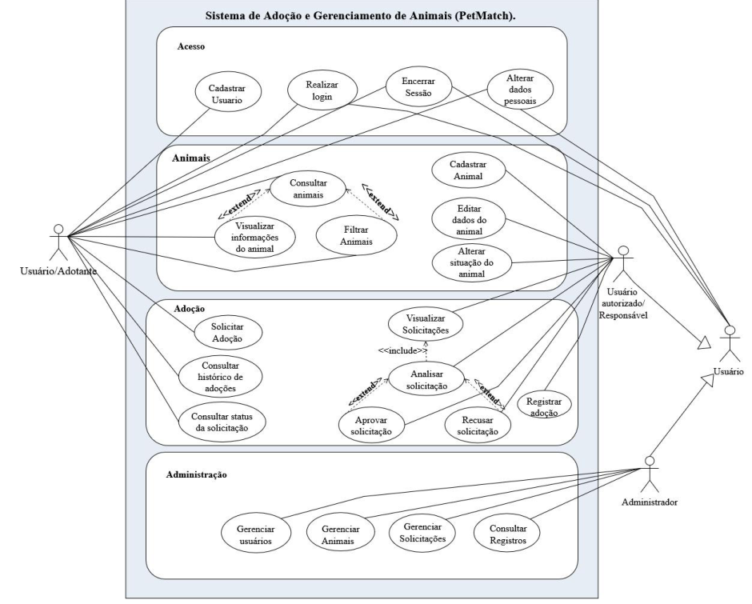
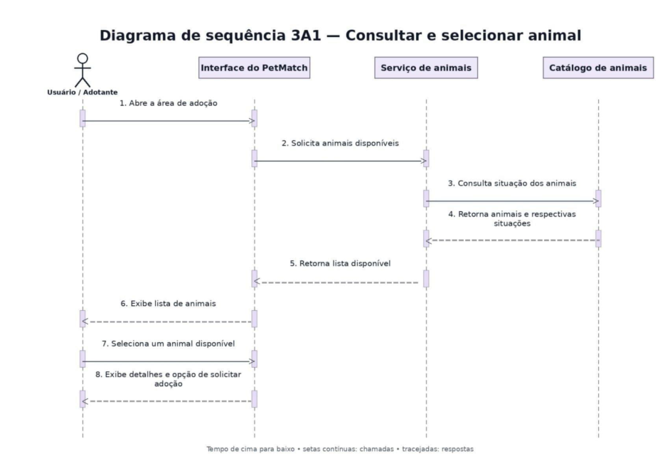
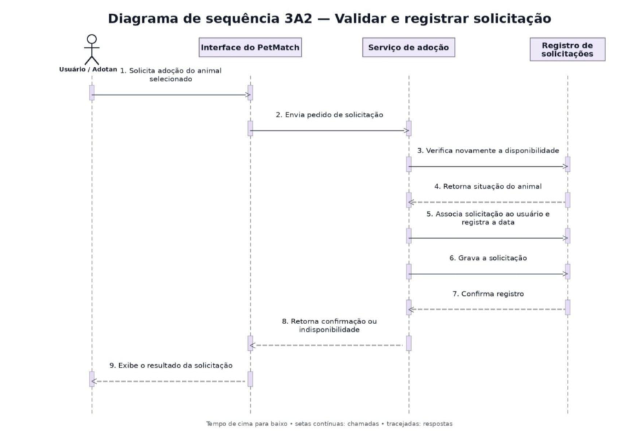
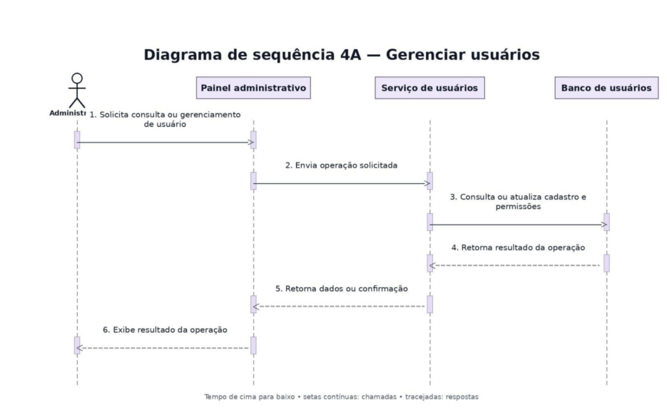
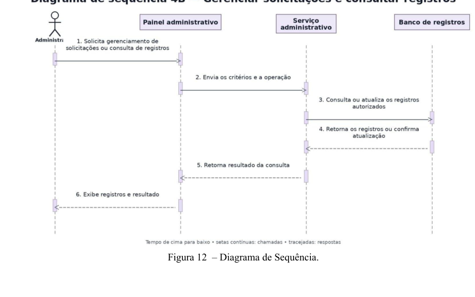

# PetMatch

**Sistema de Adoção e Gerenciamento de Animais**

Projeto acadêmico desenvolvido no curso de Engenharia de Software da Universidade Federal do Amazonas (UFAM), Instituto de Ciências Exatas e Tecnologia (ICET).

## Sumário

- [1. Introdução](#1-introdução)
  - [1.1. Descrição Geral do Software](#11-descrição-geral-do-software)
  - [1.2. Descrição dos Usuários](#12-descrição-dos-usuários)
- [2. Requisitos Gerais do Software](#2-requisitos-gerais-do-software)
  - [2.1. Requisitos Funcionais](#21-requisitos-funcionais)
  - [2.2. Requisitos Não Funcionais](#22-requisitos-não-funcionais)
  - [2.3. Regras de Negócio](#23-regras-de-negócio)
- [3. Diagramas UML](#3-diagramas-uml)
  - [3.1. Diagrama de Casos de Uso](#31-diagrama-de-casos-de-uso)
  - [3.2. Diagramas de Sequência](#32-diagramas-de-sequência)
  - [3.3. Diagrama de Atividades](#33-diagrama-de-atividades)
- [Integrantes](#integrantes)

---

# 1. Introdução

## 1.1. Descrição Geral do Software

O **PetMatch** é um sistema destinado ao gerenciamento de animais disponíveis para adoção e ao apoio ao processo de adoção responsável. A proposta é centralizar informações sobre usuários, animais, solicitações de adoção e registros de adoções, permitindo realizar consultas, cadastros, atualizações e acompanhar as etapas do processo.

O sistema contempla a divulgação dos animais cadastrados, a pesquisa por características, a solicitação de adoção por usuários cadastrados e autenticados e o gerenciamento das solicitações por pessoas autorizadas. Também prevê o registro das adoções concluídas e a consulta ao histórico correspondente.

## 1.2. Descrição dos Usuários

O PetMatch possui três perfis de usuários:

- **Usuário/Adotante:** pessoa que acessa o sistema para consultar os animais cadastrados, visualizar suas informações, aplicar filtros, solicitar a adoção de animais disponíveis e acompanhar o status das próprias solicitações.
- **Responsável pelo gerenciamento (usuário autorizado):** pessoa que possui permissão para cadastrar e editar animais, alterar a situação de adoção, visualizar e analisar solicitações, aprovar ou recusar pedidos e registrar a conclusão de uma adoção.
- **Administrador:** usuário com permissões administrativas para gerenciar usuários, animais e solicitações, além de consultar registros relacionados aos cadastros e às adoções realizadas.

# 2. Requisitos Gerais do Software

## 2.1. Requisitos Funcionais

Os requisitos funcionais descrevem as operações que o PetMatch deve oferecer.

### Usuários e acesso

| Código | Requisito | Descrição |
|---|---|---|
| RF01 | Cadastrar usuário | Permitir que um novo usuário realize seu cadastro no sistema. |
| RF02 | Realizar login | Permitir que o usuário entre no sistema utilizando suas credenciais. |
| RF03 | Encerrar sessão | Permitir que o usuário encerre sua sessão. |
| RF04 | Alterar dados pessoais | Permitir que o usuário altere seus dados cadastrais. |

### Gerenciamento de animais

| Código | Requisito | Descrição |
|---|---|---|
| RF05 | Cadastrar animal | Permitir que um usuário autorizado cadastre um animal. |
| RF06 | Editar dados do animal | Permitir que um usuário autorizado altere as informações de um animal cadastrado. |
| RF07 | Consultar animais | Permitir que os usuários consultem os animais cadastrados. |
| RF08 | Visualizar informações do animal | Apresentar os dados do animal selecionado: nome, espécie, raça, idade, sexo, porte, características, localização, situação de adoção e fotografia. |
| RF09 | Filtrar animais | Permitir filtrar animais por espécie, porte, idade, sexo, raça e disponibilidade. |
| RF10 | Alterar situação do animal | Permitir que um usuário autorizado altere a situação de adoção do animal. |

### Processo de adoção

| Código | Requisito | Descrição |
|---|---|---|
| RF11 | Solicitar adoção | Permitir que um usuário interessado solicite a adoção de um animal disponível. |
| RF12 | Visualizar solicitações | Permitir que usuários autorizados visualizem as solicitações de adoção recebidas. |
| RF13 | Analisar solicitação | Permitir que um usuário autorizado analise uma solicitação de adoção. |
| RF14 | Aprovar solicitação | Permitir que um usuário autorizado aprove uma solicitação de adoção. |
| RF15 | Recusar solicitação | Permitir que um usuário autorizado recuse uma solicitação de adoção. |
| RF16 | Consultar status da solicitação | Permitir que o usuário acompanhe o status de sua solicitação. |
| RF17 | Registrar adoção | Permitir registrar a conclusão de uma adoção. |
| RF18 | Consultar histórico de adoções | Permitir consultar o histórico de adoções realizadas. |

### Administração

| Código | Requisito | Descrição |
|---|---|---|
| RF19 | Gerenciar usuários | Permitir ao administrador consultar e gerenciar os usuários cadastrados. |
| RF20 | Gerenciar animais | Permitir ao administrador gerenciar os animais cadastrados. |
| RF21 | Gerenciar solicitações | Permitir ao administrador acompanhar e gerenciar as solicitações de adoção. |
| RF22 | Consultar registros | Permitir ao administrador consultar informações relacionadas aos cadastros e às adoções realizadas. |

## 2.2. Requisitos Não Funcionais

Os requisitos não funcionais definem critérios de qualidade e condições de funcionamento do PetMatch.

| Código | Requisito | Descrição |
|---|---|---|
| RNF01 | Usabilidade | A interface deve ser simples, intuitiva e organizada, permitindo o acesso às principais funcionalidades sem procedimentos desnecessariamente complexos. |
| RNF02 | Desempenho | Em condições normais de uso, as consultas de animais, o login e a visualização de informações devem responder em até 3 segundos. |
| RNF03 | Segurança | O sistema deve proteger os dados dos usuários contra acesso não autorizado. |
| RNF04 | Autenticação e autorização | As funcionalidades administrativas devem estar disponíveis somente para usuários autenticados e com as permissões correspondentes. |
| RNF05 | Integridade dos dados | O sistema deve preservar a consistência das informações armazenadas. |
| RNF06 | Disponibilidade | O sistema deve apresentar disponibilidade mínima de 99% ao mês, exceto durante períodos de manutenção programada. |
| RNF07 | Compatibilidade | O sistema deve ser compatível com os navegadores e ambientes definidos para sua utilização. |
| RNF08 | Manutenibilidade | A estrutura do sistema deve facilitar futuras correções, atualizações e extensões. |
| RNF09 | Privacidade | Os dados pessoais dos usuários devem ser tratados de forma adequada e protegidos contra acesso indevido. |

## 2.3. Regras de Negócio

As regras de negócio estabelecem as condições que devem ser respeitadas durante a utilização do PetMatch.

| Código | Regra | Descrição |
|---|---|---|
| RN01 | Gerenciamento de animais | Apenas usuários autorizados podem cadastrar, editar e alterar a situação dos animais cadastrados. |
| RN02 | Adoção responsável | Uma solicitação de adoção somente poderá ser aprovada após ser analisada por um usuário autorizado. |
| RN03 | Cadastro de adotantes | Apenas usuários cadastrados e autenticados poderão solicitar a adoção de animais. |
| RN04 | Controle de disponibilidade | Os animais devem possuir uma situação de adoção: **disponível**, **em processo de adoção** ou **adotado**. Animais indisponíveis não poderão receber novas solicitações. |
| RN05 | Divulgação dos animais | Os animais divulgados devem apresentar nome, espécie, raça, idade, sexo, porte, características, localização, situação de adoção e fotografia. |
| RN06 | Acompanhamento das adoções | Cada solicitação deve possuir um status atualizado, e o adotante poderá consultar somente as solicitações vinculadas à sua conta. |
| RN07 | Centralização das informações | Toda adoção concluída deve estar vinculada a uma solicitação aprovada e permanecer registrada no histórico de adoções. |
| RN08 | Controle de acesso | As funcionalidades do sistema devem ser acessadas conforme as permissões de cada perfil: adotante, responsável e administrador. |

# 3. Diagramas UML

Esta seção reúne os diagramas de modelagem do PetMatch. As imagens foram separadas para facilitar a visualização diretamente no GitHub.

## 3.1. Diagrama de Casos de Uso

O diagrama apresenta os atores do sistema — Usuário/Adotante, Usuário autorizado/Responsável e Administrador — e os casos de uso relacionados ao acesso, gerenciamento de animais, processo de adoção e administração.

## 3.2. Diagramas de Sequência

Os diagramas de sequência demonstram a interação entre os atores, a interface do PetMatch, os serviços e os registros de dados durante os principais processos do sistema.

### 3.2.1. Cadastro e login

Representa o envio dos dados de cadastro ou das credenciais, a validação pelo serviço de autenticação e a consulta ao banco de usuários.

### 3.2.2. Alteração de dados e encerramento de sessão

Apresenta a atualização dos dados do usuário, a validação e gravação das alterações e o encerramento da sessão.

### 3.2.3. Consulta, filtragem e visualização de animais

Demonstra a consulta dos animais, o envio dos filtros de pesquisa, a apresentação dos resultados e a visualização dos detalhes do animal selecionado.

### 3.2.4. Cadastro, edição e alteração da situação do animal

Apresenta as operações realizadas pelo responsável, incluindo o envio dos dados, a validação e a gravação ou atualização das informações do animal.

### 3.2.5. Consulta e seleção de animal

Representa a consulta de animais disponíveis, a verificação de suas situações e a seleção de um animal para visualizar detalhes e a opção de solicitar adoção.

### 3.2.6. Validação e registro de solicitação

Demonstra o envio de uma solicitação de adoção, a verificação da disponibilidade do animal e o registro da solicitação associado ao usuário.

### 3.2.7. Análise de solicitação

Apresenta a consulta das solicitações pendentes pelo responsável autorizado e a seleção de uma solicitação para análise.

### 3.2.8. Aprovação ou recusa de adoção

Representa a decisão do responsável autorizado e a atualização do status da solicitação conforme o resultado da análise.

### 3.2.9. Conclusão da adoção e consulta ao histórico

Demonstra o registro da conclusão de uma adoção aprovada, a atualização da situação do animal para adotado e a consulta ao histórico de adoções.

### 3.2.10. Gerenciamento de usuários

Apresenta a solicitação de consulta ou gerenciamento de usuários pelo administrador e a interação com o serviço e o banco de usuários.

### 3.2.11. Gerenciamento de solicitações e consulta de registros

Demonstra as operações administrativas relacionadas ao gerenciamento de solicitações e à consulta ou atualização dos registros autorizados.

## 3.3. Diagrama de Atividades

O diagrama de atividades apresenta o fluxo do processo de adoção, distribuído entre três participantes: **Adotante**, **Sistema PetMatch** e **Usuário Autorizado**. O fluxo contempla a consulta e filtragem dos animais, a seleção e visualização de detalhes, a solicitação de adoção, a verificação da disponibilidade, a análise do pedido e a decisão de aprovar ou recusar. Quando a adoção é aprovada e concluída, o sistema registra a adoção, atualiza a situação do animal e mantém o histórico atualizado.

---

# Integrantes

- **Ana Vitória Farias Barroso**
- **Geovanna Beathryz Amorim Paiva**
- **Jucilla Kétura Souza Sousa**

---

*Documentação elaborada a partir do Documento de Requisitos e Modelagem do PetMatch.*
