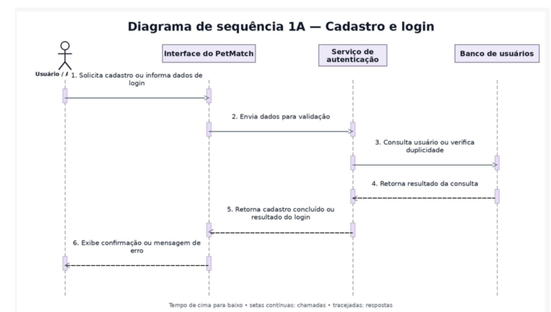
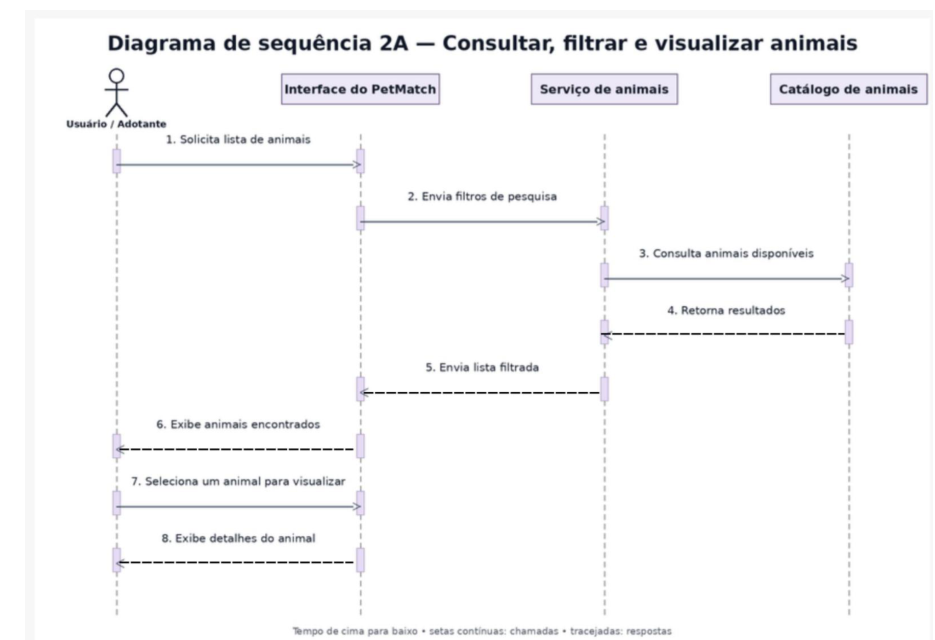
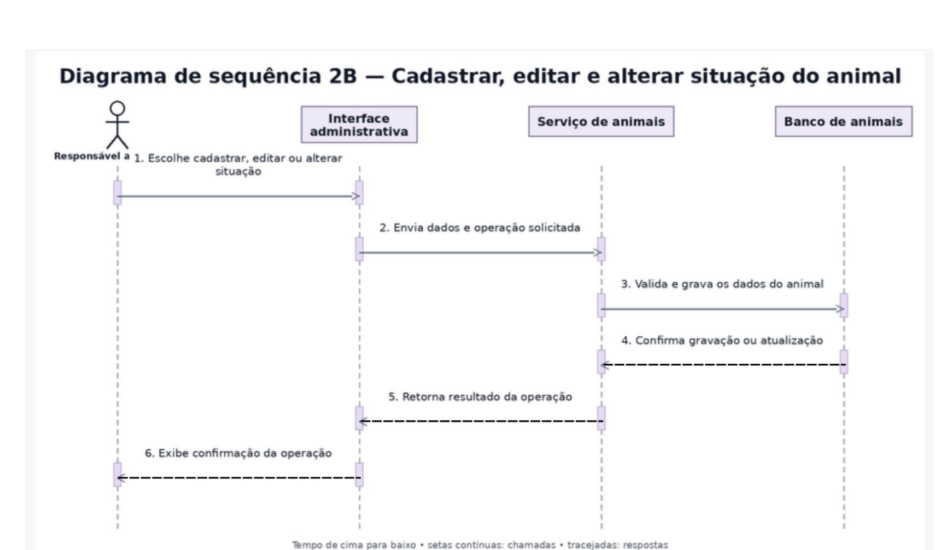
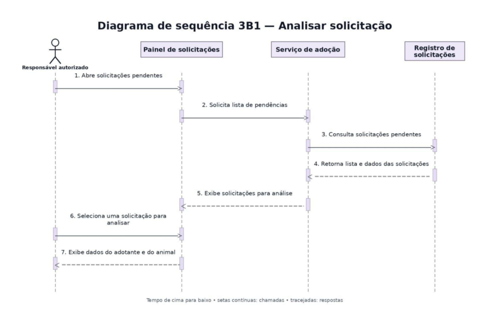
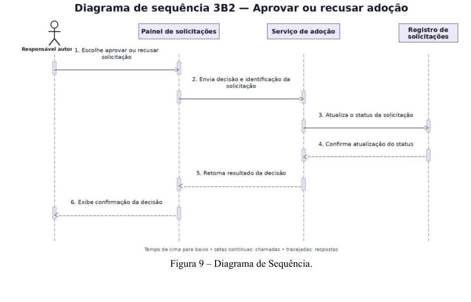

# PetMatch — Documentação e Diagramas

Documentação visual da modelagem do sistema **PetMatch**, reunindo os diagramas gerais e os fluxos detalhados de sequência.

> **Nota:** Todos os ficheiros de imagem referenciados abaixo encontram-se em `docs/diagramas/`[cite: 1, 2].

## Sumário

- [Estrutura do Repositório](#estrutura-do-repositório)
- [Diagramas Principais](#diagramas-principais)
  - [Casos de Uso](#casos-de-uso)
  - [Atividades](#atividades)
- [Diagramas de Sequência](#diagramas-de-sequência)

## Estrutura do Repositório

- `README.md`: Visão geral e galeria organizada dos diagramas do projeto[cite: 1, 2].
- `docs/diagramas/LEIA-ME.txt`: Informações e notas complementares sobre os diagramas[cite: 1, 2].
- `docs/diagramas/casos-de-uso.png`: Diagrama de casos de uso do sistema[cite: 1, 2].
- `docs/diagramas/atividades.png`: Diagrama de atividades do sistema[cite: 1, 2].
- `docs/diagramas/sequencia-01-*.png` até `sequencia-11-*.png`: Diagramas de sequência dos fluxos do sistema[cite: 1, 2].

## Diagramas Principais

### Casos de Uso

### Atividades

## Diagramas de Sequência

<strong>01 — Cadastro e Login</strong>

<strong>02 — Alterar Dados e Encerrar Sessão</strong>

<strong>03 — Consultar, Filtrar e Visualizar Animais</strong>

<strong>04 — Cadastrar, Editar e Alterar Situação do Animal</strong>

<strong>05 — Consultar e Selecionar Animal</strong>

<strong>06 — Validar e Registrar Solicitação</strong>

<strong>07 — Analisar Solicitação</strong>

<strong>08 — Aprovar ou Recusar Adoção</strong>

<strong>09 — Concluir Adoção e Consultar Histórico</strong>

<strong>10 — Gerenciar Usuários</strong>

<strong>11 — Gerenciar Solicitações e Consultar Registros</strong>

